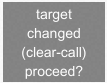

# 3.9. Flow Control State May Be Cleared When Editing

Be aware that the flow control state may be cleared when editing a job program using the teach pendant during playback or while executing `Step.FWD`.

### When moving the cursor and resuming playback,

- If you switch the screen to a job other than the currently executing job and press `Step.FWD`, the following indicator will blink.

  

  Touch the blinking indicator on the screen or press the `Left` button on the keypad to clear the call state. However, the current cursor position will be retained.

- If you press the `Start` button instead of `Step.FWD`, the call state will be cleared and execution will resume without a confirmation prompt.


### When recording, inserting, deleting, or pasting commands in a specific job,

- If a flow control statement (compound if, for, switch, or gosub) was being executed in the edited job, the following confirmation message will appear:

  `The flow control for the current job is to be cleared.`

  -> Click `OK` to clear the flow control statement state.

  (For example, if a `for`~`next` loop was in progress, execution will exit the loop at the `next` statement.)

- If a `call` was active in the edited job
  (i.e., if the edited job is included in the call stack, excluding the currently executing job),

  the following confirmation message will appear:

  `The flow control for the overall cycle is to be cleared.`

  -> Click OK to clear the call state. However, the current cursor position will be retained.

  

  * For example, if you switch programs and edit 0005.job while the following call sequence is active, the call state will be cleared.

    ```
    0001.job -> 0005.job -> 0025.job
    ```
    If you continue playback or press `Step.FWD` and execute the edited 0005.job up to the `end` statement, execution will not return to 0001.job. Instead, it will return to the beginning of 0005.job.

    On the other hand, if you edit 0025.job, which is the currently executing program, the call state will not be cleared.

- If the edited job was being executed by [task daemon](https://hrbook-hrc.web.app/#/view/doc-hi6-task-daemon/en/README?cont_model=${cont_model}) in one of the tasks, the following confirmation message will appear:

  `Task daemon will be stop and reset.`

  -> Click `OK` to reset the corresponding task daemon.
