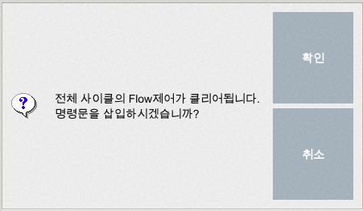

# 3.9. 편집에 의한 흐름제어 클리어

티치펜던트로 재생이나 `Step.FWD` 중에 job 프로그램을 편집할 경우, 흐름제어 상태가 클리어 될 수 있으므로 유의하십시오.


### 커서 이동하여 재생 할 때,

- 현재 실행 중인 job 제외한 다른 job으로 화면 전환하여, `Step.FWD`를 누르면, 다음 표시가 점멸합니다. 

  

  점멸 표시를 화면 터치하거나 키패드의 `좌` 버튼을 클릭하면, call 상태가 클리어됩니다. 단, 현재 커서 위치는 유지됩니다.

- `Step.FWD`가 아니라 기동 버튼을 누른 경우에는 확인 절차없이 클리어 후 실행됩니다.


### 특정 job에 명령문을 기록, 삽입, 삭제, 붙여넣기 할 때,

- 편집한 job에서 flow제어문(복문if, for, switch, gosub)을 수행 중인 상태였으면, 
  `현재 job의 Flow제어가 클리어됩니다.` 확인 메시지가 표시됩니다. 

  -> `확인` 클릭 시, flow제어문의 상태가 클리어됩니다.
  
  (가령 `for`~`next` 루프가 수행중이었다면, `next`에서 그대로 빠져나가 버립니다.)

- 편집한 job에서 `call`을 한 상태였으면,  
  (즉 현재 실행 중인 job 제외한 callstack에 편집한 job이 포함되어 있으면)

  `전체 사이클의 Flow제어가 클리어됩니다.` 확인 메시지가 표시됩니다.

  -> `확인` 클릭 시, call 상태가 클리어됩니다. 단, 현재 커서 위치는 유지됩니다.

  

  * 예를 들어, 아래와 같이 call한 상태에서 프로그램을 전환해 0005.job에 대해 편집을 수행하면 call 상태가 클리어됩니다.

    ```
    0001.job -> 0005.job -> 0025.job
    ```
    그대로 재생이나 `Step.FWD`를 진행해 편집한 0005.job에서 `end` 문까지 수행하면 0001.job으로 리턴하는 것이 아니라 0005.job의 시작위치부터 다시 되돌아갑니다.

    반면, 실행 중이던 프로그램인 0025.job에 대해 편집을 수행한 경우에는 call 상태가 클리어되지 않습니다.
  
- 편집한 job이 task 중 하나에서 [task daemon](https://hrbook-hrc.web.app/#/view/doc-hi6-task-daemon/ko/README?cont_model=${cont_model}) 수행 중이었으면,   
  `Task daemon이 정지 및 리셋됩니다.` 확인 메시지가 표시됩니다. 
  
  -> `확인` 클릭 시, 해당 task daemon이 리셋됩니다.
