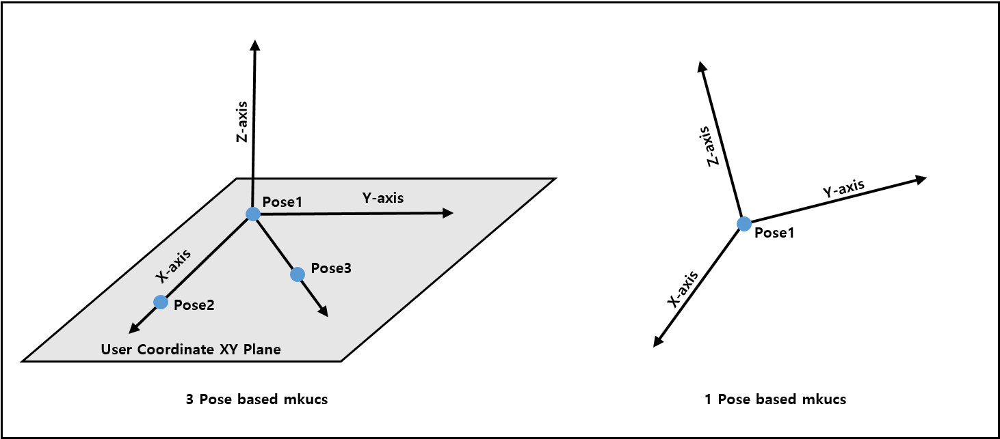

# 5.5 mkucs함수 - 사용자좌표계

### 설명

세 개의 포즈 혹은 한 개의 포즈로 사용자좌표계를 생성하는 명령어입니다.   

- 세 개의 포즈로 생성시 지정된 스텝 순서에 따라 원점포즈, 방향포즈, 평면포즈로 사용자 좌표계를 생성합니다.
- 스텝 순서를 지정하지 않으면 원점포즈, X방향포즈, XY평면포즈로 사용자 좌표계를 생성합니다.
- 한 개의 포즈로 생성시 원점포즈로 사용자 좌표계를 생성하며 위치/방향은 해당 포즈 값을 기준으로 생성합니다.
- 계산할 수 없는 경우, 에러가 발생하면서 job 실행이 중단됩니다.
- 마지막 인수로 기준 좌표계를 지정하면 사용자 좌표계가 해당 기준 좌표계 상에 정의됩니다. 지정하지 않으면 베이스 좌표계를 기준으로 정의됩니다. (V70.06-00부터 지원)


### 문법

```python
<결과변수> = mkucs(<사용자좌표계 번호>,<스텝순서>,<원점포즈>,<방향포즈>,<평면포즈>)
또는
<결과변수> = mkucs(<사용자좌표계 번호>,<스텝순서>,<원점포즈>,<방향포즈>,<평면포즈>,<기준 좌표계>)
또는
<결과변수> = mkucs(<사용자좌표계 번호>,<원점포즈>,<방향포즈>,<평면포즈>)
또는
<결과변수> = mkucs(<사용자좌표계 번호>,<원점포즈>)
또는
<결과변수> = mkucs(<사용자좌표계 번호>,<원점포즈>,<기준 좌표계>)
```


세 개의 포즈와 함께 기준 좌표계를 지정하려면 스텝 순서도 반드시 지정해야 합니다.<br>
(예) mkucs(1,"OXY",po1,po2,po3,"robot")


### 파라미터

<table>
  <thead>
    <tr>
      <th style="text-align:left">항목</th>
      <th style="text-align:left">의미</th>
      <th style="text-align:left">기타</th>
    </tr>
  </thead>
  <tbody>
  <tr>
      <td style="text-align:left">결과변수</td>
      <td style="text-align:left">
        백그라운드 수행 결과<br>
        <ul>
        <li>0: 성공적으로 완료됨.</li>
        <li>-1: 사용자 좌표계 생성 실패함.</li>
        </ul>
      </td>
      <td style="text-align:left">변수</td>
    </tr>
    <tr>
      <td style="text-align:left">사용자좌표계 번호</td>
      <td style="text-align:left">
        생성할 사용자좌표계의 번호
      </td>
      <td style="text-align:left">[1~20]</td>
    </tr>
    <tr>
      <td style="text-align:left">스텝 순서</td>
      <td style="text-align:left">
        하기 3개의 포즈에 대한 순서, 미지정시 "OXY"로 동작 <br>
        (예시) <br>
        "OXY" : 원점 포즈, X축상 포즈, XY평면상 포즈 <br>
        "OYZ" : 원점 포즈, Y축상 포즈, YZ평면상 포즈 <br>
      </td>
      <td style="text-align:left">문자열</td>
    </tr>
    <tr>
      <td style="text-align:left">원점포즈</td>
      <td style="text-align:left">
        원점에 위치한 포즈
      </td>
      <td style="text-align:left">포즈변수</td>
    </tr>
    <tr>
      <td style="text-align:left">방향포즈</td>
      <td style="text-align:left">
        X, Y, Z축에 위치한 포즈
      </td>
      <td style="text-align:left">포즈변수</td>
    </tr>
    <tr>
      <td style="text-align:left">평면포즈</td>
      <td style="text-align:left">
        XY, YZ, ZX의 평면에 위치한 포즈
      </td>
      <td style="text-align:left">포즈변수</td>
    </tr>
    <tr>
      <td style="text-align:left">기준 좌표계</td>
      <td style="text-align:left">
        사용자 좌표계의 위치 및 방향을 정의하는 기준 좌표계, 미지정시 "base"로 동작 (V70.06-00부터 지원) <br>
        <ul>
        <li>"base" : 베이스 좌표계 상에서 사용자 좌표계 위치를 정의합니다. 로봇 또는 부가축이 이동해도 사용자 좌표계 위치가 변하지 않습니다.</li>
        <li>"robot" : 로봇 좌표계 상에서 사용자 좌표계 위치를 정의합니다. 주행축이 움직일 경우 사용자 좌표계의 절대 위치가 로봇과 함께 이동합니다.</li>
        <li>"positioner-n" : n번 포지셔너 그룹(1~8)의 포지셔너 좌표계 상에서 사용자 좌표계 위치를 정의합니다. 포지셔너가 움직이면 사용자 좌표계의 위치가 포지셔너와 함께 이동합니다. 해당 포지셔너는 캘리브레이션이 완료되어 있어야 합니다.</li>
        </ul>
        "robot", "positioner-n" 지정시 각 포즈에 기록된 부가축(주행축/포지셔너) 값을 기준으로 기준 좌표계의 위치를 계산합니다.
      </td>
      <td style="text-align:left">문자열</td>
    </tr>
  </tbody>
</table>

### 리턴값


<table>
  <thead>
    <tr>
      <th style="text-align:left">값</th>
      <th style="text-align:left">의미</th>
      <th style="text-align:left">기타</th>
    </tr>
  </thead>
  <tbody>
    <tr>
      <td>0</td>
      <td>
        성공
      </td>
      <td></td>
    </tr>  
  </tbody>
</table>


### 에러 가이드

- E14613 : 티칭 된 포즈의 개수가 부족할때 발생합니다. 1개 혹은 3개의 포즈를 입력하여 주십시오.
- E14614 : 사용자좌표번호가 숫자가 아닐때 발생합니다. 사용자좌표번호를 다시 지정하십시오.
- E14615 : 사용자좌표번호가 1~20 사이의 숫자가 아닐 때 발생합니다. 사용자좌표번호를 변경하십시오.
- E1011 : 티칭 된 포즈간 거리가 너무 가까울때 발생합니다. 각 점간 거리가 1mm이하일 때 발생합니다. 포즈간 거리값을 수정하여 주십시오.
- E1012 : 티칭 된 세 개의 포즈가 일직선상에 있을때 발생합니다. 
- E14614 : 세 개의 포즈와 기준 좌표계를 지정하면서 스텝 순서를 지정하지 않았을 때 발생합니다. 스텝 순서를 지정하십시오.
- E14615 : 기준 좌표계가 "base", "robot", "positioner-n"(n: 1~8)이 아닐 때 발생합니다. 기준 좌표계를 다시 지정하십시오.
- E1287 : 기준 좌표계를 "positioner"로 지정하면서 포지셔너 그룹 번호를 지정하지 않았거나, 구성되지 않은 포지셔너 그룹을 지정했을 때 발생합니다. 포지셔너 그룹 번호를 확인하십시오.
- E1288 : 기준 좌표계로 지정한 포지셔너의 캘리브레이션이 실행되지 않았을 때 발생합니다. 포지셔너 캘리브레이션을 실행하십시오.


### 사용 예

```python
   var p_origin=Pose(0,0,0,0,0,0,"base")
   var p_xaxis=Pose(100,0,0,0,0,0,"base")
   var p_xyplane_=Pose(100,100,0,0,0,0,"base")
   var uc1 = mkucs(1,p_origin,p_xaxis,p_xyplane)
   var uc2 = mkucs(2,p_origin)
   var uc3 = mkucs(1,"OXY",p_origin,p_xaxis,p_xyplane)
   var uc4 = mkucs(3,"OXY",p_origin,p_xaxis,p_xyplane,"robot")
   var uc5 = mkucs(4,"OXY",p_origin,p_xaxis,p_xyplane,"positioner-1")
   var uc6 = mkucs(5,p_origin,"robot")
   end
```



